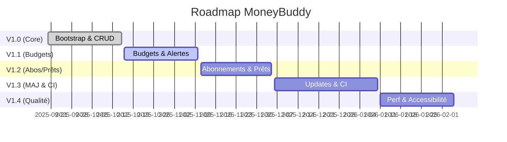

# Roadmap – MoneyBuddy

## Vision
Gérer ses finances mois par mois, optimiser l’épargne, garder une vue claire des dépenses.

## Versions
- **V1.0 – Core finance**
  - [ ] feat: bootstrap MAUI (#01)
  - [ ] feat: modèles & SQLite (#02)
  - [ ] feat: navigation Shell (#03)
  - [ ] feat: transactions CRUD (#04)
  - [ ] feat: catégories (#05)
  - [ ] feat: quick add sheet (#06)
  - [ ] feat: dashboard KPI (#07)

- **V1.1 – Budgets & alertes**
  - [ ] feat: budgets par catégorie (#10)
  - [ ] feat: alertes contextuelles (#11)
  - [ ] feat: rapports mensuels (#12)

- **V1.2 – Abonnements & prêts**
  - [ ] feat: abonnements auto-post (#20)
  - [ ] feat: prêts + échéancier (#21)
  - [ ] feat: notifications & réglages (#22,#23)

- **V1.3 – Mises à jour & CI**
  - [ ] feat: vérification de mise à jour (#30)
  - [ ] feat: pipelines CI (Android/Windows) (#31)
  - [ ] feat: Windows App Installer (option) (#32)
  - [ ] feat: export/import JSON/CSV (#33)

- **V1.4 – Qualité/Perfs/Accessibilité**
  - [ ] feat: accessibilité & responsive (#40)
  - [ ] feat: optimisations perfs (#41)
  - [ ] docs/chore: polissage + FAQ + diag (#42,#43)

## Timeline (Mermaid)

## Liens
- Milestones: v1.0 · v1.1 · v1.2 · v1.3 · v1.4
- Releases: tags `vX.Y.Z`
